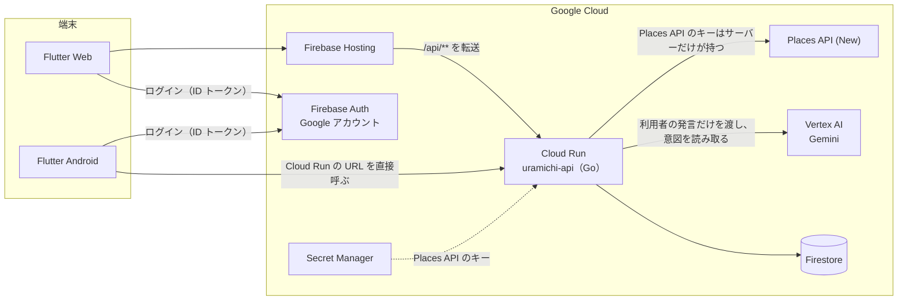

# ウラミチ

**「レビュー0件。なら、自分が最初に行けばいい。」**
みんなが行く有名スポットの代わりに、まだ知られていない場所へ行く旅を楽しむための観光アプリです。

DevFest GDGoC Japan Hackathon 2026（大阪会場）のチーム **Ascend Beyond California** の提出作品です（カテゴリ：**観光**）。

- **デプロイ URL**：https://devfest-gdgoc-japan-hackathon.web.app
- Google アカウントでログインして使います。初回はニックネームとアイコンを選びます

---

## どんなアプリか

ふつう、Google マップの口コミ数は「人気の証拠」として使われます。ウラミチはこれを逆に読み、**「まだ知られていない度合い（未知度）」**として使います。

たとえば「清水寺」と入れると、近くにあるジャンルの近い場所のうち、口コミ数が桁違いに少ない寺や庭を、口コミ数の差を示す棒グラフと一緒に提案します。行ってチェックインすると御朱印のような「ウラミチ印」が押され、このアプリで何人目の訪問者かが記録されます。1人目なら金色の「一番乗り」です。

観光客を有名スポットの外へ動かし、混雑を和らげることと、地域の小さな店や寺社に人を届けることを、1つの仕組みで同時に狙います。

## できること

| 機能 | 内容 |
|---|---|
| 未踏サーチ | 周辺の場所を、未知度と称号（未踏・穴場・定番・超有名）付きで地図と一覧に出す。「近くを探す」と「遠くを調べる」（最大 50 km）がある |
| 代わりに行くならここ | 有名スポットの名前を入れると、近いジャンルで口コミ数が桁違いに少ない場所を、口コミ数の比率と一緒に提案する |
| 古参チェックイン | 場所から 500 m 以内でチェックインすると「ウラミチ印」が押され、何人目の訪問者かが記録される。圏外では端末に保存し、通信できるようになってから送る（何人目かはそのときに決まる） |
| 思い出ログ | チェックインした場所に★1〜5の評価と一言を残す。公開を選んだ記録は周辺のタイムラインに出る |
| シェア | ウラミチ印の画像と一言を X、LINE、Instagram へ送る（★4以上の記録だけ） |
| 実績 | 思い出ログから「はじめの一歩」「開拓者」「名誉のハズレ」など 19 種類の実績を解除する |
| Geminiちゃん | 地図の右下から話しかけると、Gemini が一言から意図・地名・ジャンルを読み取り、穴場を探したり、有名スポットの代わりを探したり、地図を移動したりする |
| お気に入り | 気になった場所を保存する |

### 未知度と称号

未知度は口コミ数 `n` から計算します（`backend/internal/places/score.go`）。

```
未知度 = (1 − log(1 + n) / log(1 + 5000)) × 100   （0〜100。口コミが少ないほど大きい）
```

| 称号 | 口コミ数 |
|---|---|
| 未踏 | 10 件以下 |
| 穴場 | 100 件以下 |
| 定番 | 1,000 件以下 |
| 超有名 | 1,001 件以上 |

## 動作確認の方法

1. デプロイ URL を開き、Google アカウントでログインします（テスト用のアカウントは用意していません）
2. 地図のタブで「近くを探す」を押すと、現在地のまわりの場所が称号付きで表示されます
3. 地図の上の検索欄に「清水寺」などの有名スポットの名前を入れ、「『清水寺』の代わりを探す」を押します
4. 地図の右下から Geminiちゃんを開き、「嵐山の近くで静かなカフェを教えて」のように話しかけます
5. チェックインは場所から 500 m 以内でのみできます。現地に行けない場合は、設定の画面で「デモデータで動かす」をオンにすると、架空の場所でチェックイン、ウラミチ印、★評価、シェアを試せます（オンのあいだはサーバーにも Google にも問い合わせません）

## 構成



- **アプリ（`app/`）**：Flutter。Web 版を Firebase Hosting で公開し、Android 版を Firebase App Distribution で配る。地図は Maps JavaScript API と Maps SDK for Android で表示する
- **API サーバー（`backend/`）**：Go。Cloud Run で動かす。Places API (New) を呼び、未知度スコアと称号を計算する。ID トークンを検証してから処理する
- **Gemini の使い方**：Gemini に渡すのは利用者の発言だけで、Places API の結果は渡さない（Google Maps Platform の利用規約 3.2.3(c)）。勧める理由の文は、口コミ数・称号・距離からテンプレートで作る（[docs/decisions.md](docs/decisions.md) の D-036）
- **データ**：チェックインと思い出ログなどは API サーバーが Firestore に保存する。Places API の内容（場所の名前や口コミ数）は保存せず、place ID だけを持つ。Firestore のセキュリティルールで、アプリからの直接の読み書きはすべて禁止している

詳しくは [docs/architecture.md](docs/architecture.md)、技術を選んだ理由と弱みは [docs/decisions.md](docs/decisions.md) にあります。

## リポジトリの中身

```
app/                  Flutter アプリ
  lib/core/           共通部分（モデル・API・保存先・ログイン・位置・地図・テーマ）
  lib/l10n/           画面の文言（app_ja.arb）と、そこから生成したクラス
  lib/features/       画面ごとの機能（地図、代わりに行くならここ、チェックイン、タイムライン、実績、Geminiちゃん、設定など）
backend/              API サーバー（Go、Cloud Run）。詳しくは backend/README.md
  internal/api/       ルーティング、認証、各 API のハンドラー
  internal/places/    Places API の呼び出し、未知度スコア、称号、ダミーデータ（mockdata/）
  internal/assistant/ Geminiちゃんの意図の読み取り（Vertex AI の Gemini と簡易版）と理由の文（テンプレート）
  internal/store/     チェックインと思い出ログの保存（Firestore、メモリ）
docs/                 設計・判断の記録・セットアップの手順
firestore.rules       Firestore のセキュリティルール
firebase.json         Hosting と Cloud Run のつなぎ
```

## 起動方法（ローカル）

API サーバー、API キー、Firebase の設定がなくても、アプリはダミーデータで全ての画面を確認できます。実機やエミュレータでの起動、ビルドの方法は [docs/build-and-run.md](docs/build-and-run.md) にまとめています。

**必要なもの**：Flutter（stable）、Go（1.26 以上）。アプリだけを確認する場合、Go は不要です。

```bash
# 1. API サーバー（ダミーデータで起動）
cd backend
make dev                          # http://localhost:8080

# 2. アプリ（別のターミナルで）
cd app
flutter pub get
flutter run -d chrome             # Web で開く
```

動作確認：`curl -H 'Authorization: Bearer alice' "http://localhost:8080/api/explore?lat=34.693&lng=135.19"`（`make dev` では、トークンの文字列がそのまま利用者の ID になります）

### アプリの設定

公開した API サーバーの URL は `app/assets/config/app_config.json` の `apiBaseUrl` に書きます。Firebase の設定と地図のキーは `app/.env`（コミットしない。例は `app/.env.example`）に書き、`dart run tool/apply_env.dart` で作ったファイルを `--dart-define-from-file` でビルドに渡します（[docs/build-and-run.md](docs/build-and-run.md)）。地図のキーと Firebase の設定はアプリに含まれるため、Google Cloud と Firebase で使える場所を制限しています。

### サーバーの設定（環境変数）

| 名前 | 既定 | 意味 |
|---|---|---|
| `PLACES_API_KEY` | なし | Places API のキー。**空ならダミーだけで動く**。本番では Secret Manager から渡す |
| `PLACES_DAILY_LIMIT` | `100` | サーバー側で止める 1 日の検索の呼び出し回数 |
| `PLACES_USER_DAILY_LIMIT` | `30` | 1 人あたりの 1 日の検索の呼び出し回数 |
| `PLACES_DETAILS_DAILY_LIMIT` | `150` | 1 日の Place Details の呼び出し回数 |
| `PLACES_TEST_UNTIL` | なし | テストのために上限をゆるめる最後の日（JST、例 `2026-11-16`）。この日までは 1 人あたりの上限をなくし、全体の上限を `PLACES_TEST_DAILY_LIMIT` にする。過ぎると自動で元に戻る |
| `PLACES_TEST_DAILY_LIMIT` | `1000` | テストの期間の、検索と Place Details の種類ごとの全体の 1 日の上限（費用の歯止め） |
| `ALLOWED_ORIGINS` | なし | CORS で許すオリジン（localhost は常に許可） |
| `AUTH_MODE` | `firebase` | `firebase` は ID トークンを検証する。`fake` はローカル専用で、トークンの文字列を uid にする |
| `STORE_MODE` | `firestore` | `firestore` は Firestore に保存する。`memory` はローカル専用で、サーバーのメモリに保存する |
| `GEMINI_MODE` | `fake` | `vertex` は Vertex AI の Gemini を呼ぶ。`fake` はキーワードで答える簡易版だけで動く |
| `GEMINI_DAILY_LIMIT`、`GEMINI_USER_DAILY_LIMIT` | `300`、`30` | 全体と 1 人あたりの 1 日の Gemini の呼び出し回数 |
| `GEMINI_MODEL`、`GEMINI_LOCATION` | `gemini-3.1-flash-lite`、`global` | Gemini のモデルとリージョン |
| `GOOGLE_CLOUD_PROJECT` | なし | `AUTH_MODE=firebase`、`STORE_MODE=firestore`、`GEMINI_MODE=vertex` のときに必要 |

`make dev` は `AUTH_MODE=fake` と `STORE_MODE=memory` で起動します。本物の API キーの入れ方、デプロイの手順は [docs/setup.md](docs/setup.md) を見てください。

### テスト

```bash
cd backend && make test
cd app && flutter test
```

開発用リポジトリでは、プルリクエストごとに GitHub Actions でテストと Web のビルドを実行し、`main` へのマージで Cloud Run へ自動でデプロイしていました（認証は Workload Identity Federation）。このリポジトリでは GitHub Actions が使えないため、ワークフローのファイルは含めていません。

## ドキュメント

| ファイル | 内容 |
|---|---|
| [docs/architecture.md](docs/architecture.md) | 構成と API の仕様 |
| [docs/decisions.md](docs/decisions.md) | 技術を選んだ理由・捨てた案・弱み |
| [docs/data-model.md](docs/data-model.md) | Firestore のデータ構造 |
| [docs/api-usage.md](docs/api-usage.md) | Places API の呼び出し回数と費用を確かめる手順 |
| [docs/setup.md](docs/setup.md)、[docs/build-and-run.md](docs/build-and-run.md) | セットアップ、ビルド、デプロイ |
| [docs/design.md](docs/design.md)、[docs/ui-tuning.md](docs/ui-tuning.md) | 画面のデザイン |
| [docs/credits.md](docs/credits.md) | 使った素材・ライブラリ・データ |
| [CONTRIBUTING.md](CONTRIBUTING.md) | 開発中のチームのルール |

## ライセンス

[MIT License](LICENSE)
