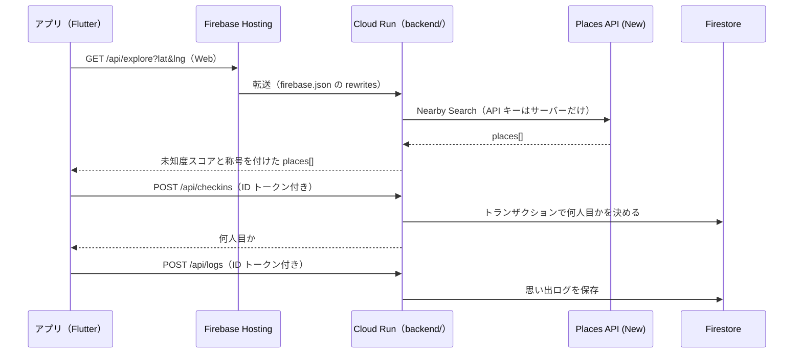

# 構成と API

## 全体



- **Places API はサーバーからだけ呼ぶ**。キーがアプリに入らず、全体と 1 人あたりの 1 日の回数をサーバーで止められる
- **Firestore を読み書きするのは API サーバーだけである**。アプリは Firebase Authentication の Google アカウントでのログインで ID トークンを受け取り、API に付けて送る。ID トークンが必要な API は、匿名ログインのトークンを `login_required` で拒否する。何人目かと思い出ログの日時はサーバーが決めるので、本人が値を偽れない
- **Web 版は Hosting と API が同じオリジン**になるので CORS の設定がいらない。Android 版は `app/assets/config/app_config.json` に Cloud Run の URL を書く
- **ダミーを使う場面**：架空の場所を本物と並べて見せないよう、API キーがあるサーバーは、Places API が失敗しても 1 日の上限に達してもダミーに切り替えず、`503 places_unavailable` か `429 daily_limit` を返す。アプリも、接続先（`apiBaseUrl`）があれば、API サーバーに接続できなくてもダミーに切り替えずに理由を表示する。ダミーを使うのは、利用者が設定の「デモデータで動かす」をオンにしたとき（サーバーにも Google にも問い合わせず、架空の場所と端末の中の記録だけを使う）、API キーのないサーバー（`make dev` の開発環境）、接続先のない開発用のビルドだけである。place ID が `mock_` で始まるダミーの場所のチェックイン、訪問者数、思い出ログは、接続先が有効でもサーバーへ送らず、端末のメモリだけで扱う。チェックインと思い出ログの保存先は「通信できないときと滞在の記録」に記述する。詳しい条件は [build-and-run.md](build-and-run.md) にある

## 通信できないときと滞在の記録

アプリは、通信できないときのチェックインと思い出ログを端末に保存し、記録した順にサーバーへ送る。送信は、起動時、アプリに戻ったとき、チェックインのタブを開いたとき、および 1 分ごとに試みる。未送信の記録と、圏外で表示する最後に読めた一覧は、ログインした利用者の uid ごとに端末へ保存する。送信には記録した利用者の ID トークンだけを使い、別の利用者がログインしているときは送らずに残す。残した記録は、記録した利用者がもう一度ログインしたときに送る。順番はサーバーが決めるため、送信するまで表示しない。日時は記録したときの値を送るので、後から送っても思い出ログの日付はずれない。思い出ログには記録ごとの `clientId` を付けるので、応答を受け取れずに送り直しても二重に保存されない。接続できない場合、応答がない場合、および API がない場合は記録を残して次の機会に送り直す。401、403、429、および 5xx の場合も記録を残し、そのほかの 4xx の場合はサーバーが受け取らない記録として送るのをやめ、件数を表示する。

利用者がスイッチをオンにして位置情報を「常に許可」にすると、Android 版は WorkManager で約 15 分ごとに位置を測定し、半径 100 m 以内に 10 分以上いた区間を滞在として端末に保存する。通知は表示しない。測定は別の isolate で動くので、測定値を `visitSamples` に追加し、アプリを開いたときに滞在へ変換する。省電力機能で間隔が空くことがあり、15 分より短い滞在は記録できないことがある。アプリを強制的に閉じると測定は止まり、次に開いたときに再開する。滞在は利用者を区別せずに端末の位置から記録するため、ログアウトすると測定を止め、滞在の記録と提案しない地点を端末から消す。Web 版は滞在を記録しない。

端末には滞在の位置と時刻だけを保存し、スポットの名前はチェックインのタブを開いたときに `/api/explore` から受け取る。圏外で記録した滞在も、通信できるようになってからスポットを特定できる。

## 環境

| 環境 | アプリ | API | Places | 保存先 |
|---|---|---|---|---|
| ローカル（既定） | `flutter run` | `cd backend && make dev`（:8080）。なくてもアプリのダミーデータで動く | ダミー | 端末 |
| ローカル（Places だけ本物） | `flutter run` | `cd backend && make real`（`.env` の `PLACES_API_KEY` を使う） | 本物 | 端末 |
| ローカル（本物） | `app/.env` の `FIREBASE_*` を設定 | `PLACES_API_KEY`、`AUTH_MODE=firebase`、`STORE_MODE=firestore`、`GOOGLE_CLOUD_PROJECT` を設定 | 本物 | Firestore |
| 本番 | Firebase Hosting / App Distribution | Cloud Run（asia-northeast1） | 本物 | Firestore |

## API

呼び出し回数と料金の測定は [api-usage.md](api-usage.md) に記述する。

応答は JSON（UTF-8）。エラーは次の形で返します。`message` は利用者に見せてよい日本語の文です。

```json
{ "error": { "code": "bad_request", "message": "lat と lng を数値で指定してください" } }
```

`/api/health` と、ローカルの開発環境だけで公開する `/api/usage` 以外の API には `Authorization: Bearer <Firebase の ID トークン>` が必要である。認証なしで呼べる API があると、外部から Firestore の読み取りやサーバーの処理を繰り返し消費できるため、Places API を呼ばない `mock=1` の検索と訪問者数にもトークンを求める。`/api/explore` と `/api/alternatives` に `mock=1` を付けるとダミーデータを返し、ダミーの場所には当たりとハズレの数を付けない。Places API の呼び出しは 1 人につき 1 日 `PLACES_USER_DAILY_LIMIT` 回まで（既定は 30 回）であり、上限に達すると全体の 1 日の上限と同じように動く。

### `GET /api/health`

サーバーの状態。Cloud Run は末尾が `z` の一部のパス（`/healthz` など）を予約していて本番では届かないため、`/api` の下に置く。

```json
{ "ok": true, "places": "google", "assistant": "gemini" }
```

`assistant` は Geminiちゃんが Vertex AI の Gemini を呼ぶ設定なら `gemini`、キーワードで答える簡易版だけなら `fake` である。

### `GET /api/usage`

今日と今月の Places API の呼び出し回数と料金の目安。`AUTH_MODE=fake` のときだけ公開し、本番では 404 を返す。`real` は本物の呼び出し、`simulated` はキーがないときに本物なら呼んでいたはずの呼び出しである。`estimatedUsd` は無料枠を引いた料金、`listPriceUsd` は無料枠を引かない料金である。

```json
{
  "date": "2026-11-07",
  "dailyLimit": 100,
  "today": {
    "real": { "calls": { "nearby.explore": 3, "text.alternatives": 1 }, "byKind": { "nearby": 3, "text": 1 }, "estimatedUsd": 0, "listPriceUsd": 0.14 },
    "simulated": { "calls": {}, "byKind": {}, "estimatedUsd": 0, "listPriceUsd": 0 }
  },
  "month": { "real": { }, "simulated": { } },
  "pricing": { "nearby": { "freePerMonth": 1000, "usdPer1000": 35 }, "text": { "freePerMonth": 1000, "usdPer1000": 35 } }
}
```

### `GET /api/explore`（A）

| クエリ | 必須 | 既定 | 意味 |
|---|---|---|---|
| `lat`, `lng` | ○ | | 探す中心 |
| `radius` | | 1500 | 半径（m、100〜5000） |
| `purpose` | | | `checkin` を指定するとチェックインの候補を探す |

応答：未知度スコアの高い順。閉業または休業中の場所は含まない。住宅、駐車場、病院などの主な種類（`backend/internal/places/visit.go` の `NonVisitablePrimaryTypes`）は Nearby Search の段階で除き、飲食、商店、公園、寺社、名所などの訪れられる種類を一つも持たない場所は、口コミが 100 件未満なら除く。バス停や駅などの停留所は訪れる場所ではないので除く（以前は名前の変わった停留所を Gemini に選ばせて残していたが、Places API の結果を Gemini に渡さないためやめた。D-036）。`purpose=checkin` のときは、最寄りのスポットを取りこぼさないよう種類で絞らずに近い順の上位 20 件を受け取り、地図と同じく訪れられる場所だけを返す（地図とチェックインで出る場所をそろえるため。近くに訪れられる場所が 1 つもなければ、今いる場所が会社や駐車場でもチェックインできるよう絞らずに返す）。本物の API が失敗したときは `503 places_unavailable`、1 日の上限に達したときは `429 daily_limit` を返す。チェックインの候補の検索は、地図の検索とは別の 1 日の上限（全体と 1 人あたり）で数える。地図で広い範囲を何度か探しただけで、チェックインできなくならないようにするため。

```json
{ "source": "google", "places": [ { "id": "...", "name": "...", "obscurity": 84, "title": "untrodden", ... } ] }
```

Places API の呼び出し：1 回（Nearby Search）。人気度の幅が知られていない場所と有名な場所の両方を含むと 2 回、3km 以上の範囲では 4 回。Gemini は呼ばない。

`genre` はジャンルの ID をカンマで区切って指定する（`food`、`nature`、`worship`、`culture`、`view`、`shopping`、`other`）。`other` を含むと、選んでいないジャンルの種類を除いて探す。未踏サーチも近い順の上位 20 件を受け取り、ウラミチの利用者が付けた当たりとハズレの数を `hits` と `misses`、★評価の平均と数を `stars` と `starCount` で返す（0 なら省く）。

`radius` は 50000 まで受け付ける（チェックインの候補は 5000 まで）。3000 以上の範囲は、中心と、中心から半径の 6 割の 3 地点の計 4 地点で探し、重ねずにまとめる。5000 より広い範囲は 40 件までを返す。ジャンルを選んでいないときは、訪れられる種類（`places.ExploreTypes`。公園・寺社・博物館・喫茶店・展望台・停留所など 50 種類）に絞って探す。絞らないと近い順の 20 件が会社や店で埋まり、訪れられる場所が数件しか残らないため。`popularity=最小,最大` は人気度の幅で、称号の段階（0 未踏・1 穴場・2 定番・3 超有名）で指定する。幅に定番か超有名を含むと人気順でも探し、幅の中の場所を先に並べる。指定しなければ近い順で 1 回探し、知られていない順に並べる（前と同じ）。

### `GET /api/places/{placeId}/photos`（A）

場所の詳細で見せる Google マップの写真。`{"source": "google", "photos": [{"url", "width", "height", "attributions": [{"name", "uri"}]}]}` を返す。

- Place Details で `photos` を読み（Pro 区分。`usage` のキーは `detailsPhotos.photos`）、最大 4 枚まで、Place Photos の media を `skipHttpRedirect=true` で呼んで画像の URL を受け取る（1 枚ごとに `photo.photos`）
- 画像の URL は短い時間だけ使え、API キーを含まない。アプリは保存せずにその場で表示する
- Google Maps の規約で、写真ごとに撮影者（`attributions`）を表示し、撮影者のページへのリンクにする
- API キーがないとき（ダミー）とダミーの場所は、写真を返さない。1 日の上限に達したときは `limited: true` と空の写真を返す
- **既定では止めている。** 1 回の表示で Places API を最大 5 回呼び、費用が高いため。サーバーの環境変数 `PLACES_PHOTOS=on` のときだけ写真を読み、それ以外は Places API を呼ばずに空の写真を返す（アプリは写真の欄を出さない）

### お気に入り（C）

- `GET /api/favorites/ids` — お気に入りの place ID だけを返す（`{"placeIds": [...]}`）。Places API を呼ばない
- `GET /api/favorites` — お気に入りの一覧（新しい順）。`{"favorites": [{"placeId", "place", "createdAt"}]}`。`place` は名前・位置・種類で、読めなかった場所は `null`。口コミ数は取得しないので、`place` に `userRatingCount` と、口コミ数から決める `obscurity`・`title` を含めず、アプリは口コミ数と称号を表示しない。Places API の呼び出し：件数分の Place Details（名前の取得と同じ区分と上限）
- `PUT /api/favorites/{placeId}` — お気に入りに入れる。1 人 100 件まで
- `DELETE /api/favorites/{placeId}` — お気に入りから外す

Firestore には place ID と日時だけを保存する（Google Maps の規約）。ダミーの場所はアプリが端末の中だけで覚える。

### `GET /api/locate`（B）

地図を移動する先を探す。`q` が場所の名前で、応答は `{ "source": "google", "name": "嵐山", "lat": 35.01, "lng": 135.67 }` である。ID トークンが必要で、`mock=1` を付けるとダミーの地点を返す。見つからなければ `404 place_not_found`、Places API が失敗したか上限に達したときは `503 places_unavailable` を返す。

### `GET /api/alternatives`（B）

| クエリ | 必須 | 既定 | 意味 |
|---|---|---|---|
| `q` | ○ | | 有名スポットの名前 |
| `radius` | | 3000 | 周辺を探す半径（m、500〜10000） |

応答：`origin` が特定した有名スポット、`alternatives` が提案（最大 10 件、有名スポットから近い順）である。サーバーは有名スポットから `radius` の 40% だけ離れた 3 地点を中心に、同じ距離を半径として、主な種類で絞った Nearby Search を人気順で行う。提案するのは、次の条件を全て満たす場所だけであり、条件を満たす場所が少なければ少ないまま返す。アプリは候補が 3 件未満のときに範囲を広げる操作を表示する。

- 有名スポットから 300 m 以上離れている
- `containingPlaces` がなく、別の場所の敷地や施設の中にない
- 口コミが 20 件以上 1000 件以下で、有名スポットより少ない

有名スポットを中心に近い順で探すと敷地内の門や像で 20 件が埋まり、人気順で探すと近隣の有名な場所で 20 件が埋まるため、中心を外している。

```json
{
  "source": "google",
  "origin": { "id": "...", "name": "清水寺", "obscurity": 0, "title": "famous", ... },
  "alternatives": [ { "id": "...", "name": "...", "distanceMeters": 820, ... } ]
}
```

見つからないときは `404 origin_not_found`。

Places API の呼び出し：4 回（Text Search 1 回 ＋ Nearby Search 3 回）。1 地点の検索が失敗した場合は、残りの地点の結果を返す。

### `POST /api/checkins`（C）

`Authorization: Bearer <Firebase の ID トークン>` が必要。ボディは `{ "placeId": "ChIJ...", "lat": 34.69, "lng": 135.19, "visitedAt": "2026-11-05T01:02:03.000Z" }`。`lat` と `lng` は現在地、または後からチェックインするときの滞在の位置で、必須である。`visitedAt` は省略できる。2 回目以降もエラーにせず、位置を確かめずに 1 回目の順番と `isNew: false` を返す。順番は `visitedAt` に関係なく、サーバーが受け取った順に決まる。

初回は Place Details で場所の位置を読み、場所が存在しなければ `404 place_not_found`、指定された位置から 500 m より遠ければ `400 too_far` を返す。Place Details が失敗したときや 1 日の上限に達したときは `503 places_unavailable` を返し、アプリは記録を端末に残して送り直す。API キーがない環境ではダミーの場所だけを受け取り、距離を確かめない。

```json
{ "order": 1, "isNew": true }
```

### `GET /api/places/{placeId}/visitors`（C）

訪問者数。ID トークンが必要で、誰も来ていなければ 0 を返す。

```json
{ "visitorCount": 3 }
```

### `POST /api/logs`（C）

ID トークンが必要。成功すると `201` で保存した 1 件を `placeName` なしで返す。

```json
{ "placeId": "ChIJ...", "rating": 2, "comment": "閉まってた", "visitedAt": "2026-11-05T01:02:03.000Z", "clientId": "1762300000_12345" }
```

- `order` はサーバーが決め、送られても読まない。`placeName` と位置も送られても読まず、保存しない
- `public` が true の記録は周辺のタイムラインに公開する。公開の範囲は距離を確かめたチェックインの地点で決まる
- 同じ人が同じ場所に複数の記録を残すと、当たりとハズレの数と★評価は、いちばん後に訪問した記録（訪問日時が同じときは ID の大きい記録）の 1 票として数える。圏外で残した前の訪問が後から届いても、票は変えない
- `createdAt` は `visitedAt` の値になる。`visitedAt` がない場合、読めない場合、現在より 5 分以上未来の場合、および 30 日より古い場合はサーバーの時刻になる。`createdAt` は UTC で返し、アプリは端末の時刻に直して表示する
- `clientId` は記録ごとにアプリが決める値（英数字、`_`、`-` で 64 文字まで）である。同じ値で送り直すと、新しく保存せずに保存済みの 1 件を返す
- `rating` は★評価（1〜5）。送ると `verdict` は★3 以上を `hit`、それ以外を `miss` にする。★評価に対応する前のアプリは `rating` を送らず、`verdict`（`hit` または `miss`）だけを送る。`comment` は前後の空白を除いて 140 文字まで
- `photoPath` は `users/{自分の uid}/` で始まる必要がある

### `GET /api/logs`（C）

`placeName` は保存せず、place ID ごとに Place Details で読んで返す。読めなかった場所では `placeName` を省く。`names=0` を付けると名前を読まない（Places API の 1 人あたりの上限を使わない）。アプリは名前を表示しない画面（実績、残す前の記録の確認）で `names=0` を使う。`known=id1,id2`（最大 200 件）には、アプリがすでに名前を知っている場所（検索の結果などで受け取った場所）を入れ、その場所の名前は読まずに省く。アプリは受け取った名前を、端末に保存せずアプリを閉じるまでだけ覚えておき、省かれた名前を埋める。`GET /api/timeline` も同じ `known` を受け付ける。

ID トークンが必要。自分の思い出ログを新しい順に返す。

```json
{ "logs": [ { "id": "lg_01JC...", "placeId": "ChIJ...", "placeName": "坂の上の小さな祠", "verdict": "miss", "comment": "閉まってた", "order": 1, "createdAt": "2026-11-08T03:12:45Z" } ] }
```

### `PATCH /api/logs/{logId}`（B）

ID トークンが必要。ボディは `{ "rating": 4, "comment": "...", "public": true }` で、送った項目だけ自分の記録を直す。`rating` を変えると `verdict` も★評価から決め直す。直した記録がその場所でいちばん後に訪問した記録なら、場所への 1 人 1 票も直した★評価に入れ替える（古い記録を直しても票は変えない）。公開中の記録は周辺のタイムラインにも反映する。応答は直した後の記録。

### `GET /api/timeline`（B）

ID トークンが必要。`lat` と `lng` の地点の区画と周囲の 8 区画（5 文字の geohash、1 区画は約 5 km 四方）で公開された記録を、新しい順に最大 20 件返す。`scope=all` を付けると、場所を問わず全国で公開された記録の新着を最大 20 件返す（`lat` と `lng` はいらない）。全国の新着は、複合インデックスを増やさないよう日時の並びだけで読み、公開中のものをサーバーで選ぶ。報告した人が 3 人に達した記録は返さない。自分が報告した記録は、自分には返さない。

```json
{ "entries": [ { "id": "...", "author": "3F9A...", "authorName": "たろう", "authorIcon": "hiker", "mine": false, "placeId": "ChIJ...", "placeName": "...", "verdict": "hit", "comment": "...", "order": 2, "createdAt": "2026-11-07T00:00:00Z" } ] }
```

`author` は uid から作った符号で、uid は返さない。`authorName` と `authorIcon` は投稿者のプロフィールの値で、投稿者がプロフィールを保存していなければ空の文字列になる。プロフィールを変更すると、過去の記録の表示も変わる。

### `POST /api/timeline/{entryId}/report`（B）

ID トークンが必要。公開された記録を報告する。ボディは `{"reason": "inappropriate|unrelated|personal|spam|other", "note": "ひとこと（200 文字まで、任意）"}`。理由を送らない古いアプリの報告は `other` として受け付ける。理由とひとことは `timeline/{id}/reports/{uid}` に保存し、運営が Firestore で読んで対応を決める。報告したことは投稿者に伝えない。同じ人の 2 回目は数えない。

### `GET /api/me`

ID トークンが必要。自分のプロフィールを返す。まだ保存していなければ `profile` は `null` になり、アプリはニックネームの入力画面を表示する。

```json
{ "profile": { "nickname": "たろう", "icon": "hiker" } }
```

### `PUT /api/me`

ID トークンが必要。ボディは `{ "nickname": "たろう", "icon": "hiker" }` で、自分のプロフィールを保存し、`GET /api/me` と同じ形で返す。`nickname` は前後の空白を除いて 1〜20 文字で、改行を含められない。`icon` はアプリが用意したアイコンの ID で、サーバーは英小文字、数字、`_` の 1〜32 文字であることだけを確かめる。Google アカウントの名前と写真は、実名と顔写真の場合があるため保存しない。

### `POST /api/photos`（C）

ID トークンが必要。ボディは画像のバイト列（JPEG、PNG、WebP。900KB まで）で、記録に付ける写真を保存して `{ "id": "ph_..." }` を返す。種類は申告ではなく中身の先頭のバイトで決める。アプリは長い辺を 1280px に縮めて JPEG にしてから送る。写真は Firestore の `photos/{id}` に保存する（Cloud Storage のバケットと権限の設定を増やさないため。ハッカソンの規模の判断で、docs/decisions.md の D-034）。`POST /api/logs` の `photoId` に、この ID を入れる（自分が上げた写真だけを付けられる）。

### `GET /api/photos/{photoId}`（C）

ID トークンが必要。写真のバイト列を返す。ID は推測できないランダムな 128 ビットの値で、ログインした人ならだれでも読める（公開した記録の写真をタイムラインで見せるため）。

### `PUT` / `DELETE /api/timeline/{entryId}/reactions/{kind}`（B）

ID トークンが必要。公開された記録に「行ってみたい」（`want`）や「参考になった」（`helpful`）を付け外しし、`{ "wantCount": 3, "helpfulCount": 1, "myWant": true, "myHelpful": false }` を返す。1 人 1 回で、同じ反応を重ねても数えない。自分の記録には反応できない（`400`）。`GET /api/timeline` の各記録にも同じ 4 つの項目が付き、`GET /api/logs` の公開した記録には `wantCount` と `helpfulCount` が付く。

### `PUT /api/me/achievements`

ID トークンが必要。本文は `{ "tiers": { "pioneer": 2, "night_owl": 1 } }` で、自分が解除した実績の ID と段階（段階のない実績は 1、最大 3）を送る。実績はアプリが思い出ログから決めるので、サーバーは受け取った値で利用者ごとの記録（`achievements/{uid}`）を置き換え、全体の集計（`stats/achievements`）を差分で更新する。前と同じ内容なら何も書かない。アプリは実績の画面を開いたときに送る。

### `GET /api/achievements/stats`

ID トークンが必要。`{ "users": 120, "achievements": { "pioneer": [30, 8, 2] } }` を返す。`users` は実績を送った利用者の数（まだ何も解除していない人を含む）、配列は段階 1〜3 それぞれの、その段階以上を解除した人数。アプリは実績ごとに「全体の何%が解除」を見せる。

### `POST /api/assistant`（D）

Geminiちゃん。利用者の一言から意図を読み取り、穴場のおすすめと理由、または地図で探す条件を返す。ID トークンが必要である。

```json
{ "message": "嵐山の近くで静かなカフェを教えて", "lat": 35.0094, "lng": 135.6668,
  "history": [ { "role": "user", "text": "近くの穴場を教えて" }, { "role": "assistant", "text": "3か所選びました" } ] }
```

- `message` は前後の空白を除いて 1〜200 文字。`lat` と `lng` は地図の中心で、両方そろったときだけ使い、一言に地名がない依頼の中心にする
- `history` は直前のやり取り（古い順）。サーバーは新しいものから 6 件だけ読み、1 件 400 文字で切る。サーバーには保存しない
- `context` は利用者の状況（任意）。`{"timeOfDay": "朝|昼|夕方|夜|深夜", "weekend": bool, "onSite": bool, "area": "見ている地域", "liked": ["最近気に入った場所"]}`。Gemini には渡さない（理由の文をテンプレートで作るため、今は使っていない）。知らない時間帯は捨て、文字列は 30 文字、`liked` は 3 件で切る。保存しない

処理：

1. Gemini で一言の意図（`intent`）、地名（`area`）、ジャンルを読み取る
2. 意図に応じて今の検索を呼ぶ。`recommend` は `area` があれば地点の検索で中心を決め、半径 1500 m を Nearby Search して超有名を除く。`alternatives` は `/api/alternatives` と同じ処理（半径 3000 m）。`locate` は地点の検索だけ。`chat` は何も探さない
3. 候補（未知度の高い順に最大 8 件）があれば、上から最大 3 件を選び、口コミの数・称号・距離から理由の文をテンプレートで作る。Places API の結果は Gemini に渡さない（Google Maps Platform の利用規約 3.2.3(c)。D-036）。Gemini に渡すのは利用者の発言だけで、それまでのアプリの答え（場所の名前を含む）も渡さない

```json
{
  "source": "gemini",
  "placesSource": "google",
  "intent": "recommend",
  "reply": "嵐山の近くで、落ち着けそうなカフェを3つ選びました。",
  "center": { "name": "嵐山", "lat": 35.0094, "lng": 135.6668 },
  "search": { "genres": ["food"] },
  "suggestions": [ { "place": { "id": "...", "name": "...", "title": "hidden", "distanceMeters": 420, ... }, "reason": "口コミが12件と少ない喫茶店です。" } ]
}
```

| 項目 | 意味 |
|---|---|
| `source` | 文を作ったもの。`gemini`、または簡易版の `fake`（1 回でも簡易版を使えば `fake`） |
| `placesSource` | 候補の出どころ（`google` / `mock`）。場所を探さなかったときは省く |
| `intent` | `recommend`（穴場のおすすめ）、`alternatives`（代わりに行くならここ）、`locate`（地図の移動）、`chat` |
| `center` | 探した中心、または移動する先。地図の中心を使ったときの `name` は「地図の中心」 |
| `search` | 地図で同じ条件を探すための条件。`genres` はジャンルの ID、`query` は代わりを探した有名スポットの名前 |
| `suggestions` | おすすめ（最大 3 件）。`place` は Place と同じ形で、`distanceMeters` は `center` からの距離 |

- Gemini が失敗したとき、8 秒で応答がないとき、1 日の上限（全体 `GEMINI_DAILY_LIMIT`、1 人 `GEMINI_USER_DAILY_LIMIT`）に達したときは、キーワードで答える簡易版に切り替える。エラーにはしない
- 地名や有名スポットが見つからないとき、Places API が失敗したときも、エラーにせず `reply` で伝え、`suggestions` を空にする
- エラーは `400 bad_request`（`message` がない・長すぎる、`lat` と `lng` が範囲外）と `401 unauthenticated` だけ

呼び出し：Gemini 最大 2 回、Places API 最大 2 回（地点の検索または Text Search ＋ Nearby Search）。回数の記録のキーは `gemini.assistant`、`nearby.assistant`、`text.assistant`、`locate.map` である。

### 実績（アプリだけ）

実績には API がない。アプリが `CheckinRepository.watchLogs()` の思い出ログから計算する（`app/lib/features/achievements/achievements.dart`、D-018）。

### エラーの code

| HTTP | code | 意味 | 出る API |
|---|---|---|---|
| 400 | `bad_request` | パラメータの不足や形式の誤り | 全て |
| 400 | `not_checked_in` | チェックインしていない場所の思い出ログ | `POST /api/logs` |
| 400 | `too_far` | チェックインする場所から 500 m より遠い | `POST /api/checkins` |
| 404 | `place_not_found` | チェックインする場所が存在しない | `POST /api/checkins` |
| 401 | `unauthenticated` | ID トークンがない、または無効 | ID トークンが必要な全ての API |
| 403 | `permission_denied` | 他人のパスの写真を指定した | `POST /api/logs` |
| 403 | `login_required` | 匿名ログインの ID トークンで呼んだ | ID トークンが必要な全ての API |
| 404 | `origin_not_found` | 有名スポットが見つからない | `/api/alternatives` |
| 404 | `not_found` | 未定義のパス | 全て |
| 500 | `internal` | サーバーの処理の失敗 | 全て |
| 501 | `not_implemented` | 未実装（Plan B の `/api/gacha`） | `/api/gacha` |
| 429 | `daily_limit` | チェックインの候補を探す Places API の 1 日の上限に達した | `/api/explore?purpose=checkin` |
| 503 | `places_unavailable` | チェックインの候補、場所の位置、地図を移動する先を本物の Places API から受け取れない | `/api/explore?purpose=checkin`、`POST /api/checkins`、`/api/locate` |

## 新しい API を足すとき

1. `backend/internal/api/` にハンドラを作る
2. `backend/internal/api/server.go` の `Handler` に 1 行足す
3. `backend/internal/api/api_test.go` にテストを足す
4. `app/lib/core/api/uramichi_api.dart` にメソッドを足す
5. このファイルの「API」に書く
